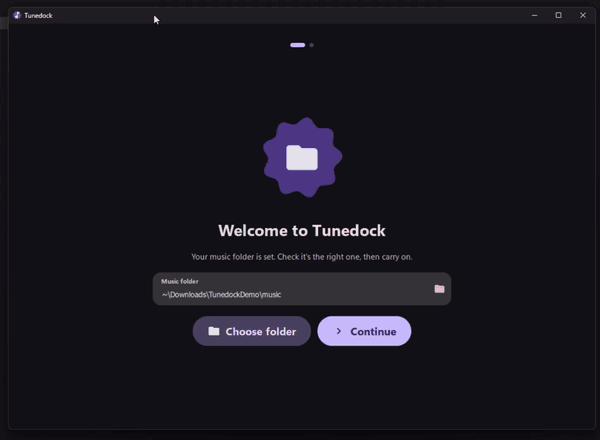

# Tunedock

Right-click music in Explorer → **Add to music library**. Tunedock converts it (Opus by default), keeps tags and cover art,
names it the way you choose, and puts it in the right folder of your library.

> **Status: unmaintained.** This is a personal project, shared as-is. I make changes here and there,
> but issues and pull requests are closed and nothing is promised. If you'd like to take it further, please fork it.
> MIT licensed (see `LICENSE` and `THIRD_PARTY_NOTICES.md`).

## Demo

## Disclaimer
Tunedock is provided **as is, with no warranty** (see `LICENSE`). It converts, renames, moves and, if you turn those options on,
deletes or recycles your music files, and it adds entries to your user registry (right-click menu, optional start with Windows).
**Back up your library before using it on music you can't replace.** It has had limited real-world testing, mostly on one
Windows 11 PC. The release exe is unsigned, so Windows or your antivirus may warn about it. Use it at your own risk.

## AI usage
This project was written almost entirely by AI (Claude, through the OpenCode coding agent), directed and tested by me.
I haven't reviewed every line by hand. The automated tests in `tests/` and my own use are what back it up, so treat it as
you would any untrusted third-party code: read it before you trust it with anything important.

## Download (easiest)
Get the latest stable zip from the [**Releases**](../../releases/latest) page, unzip it anywhere, and run
`Tunedock\Tunedock.exe`. Every commit also gets a `build-N` pre-release with the newest changes (only the last 2 are kept). No Python needed. The first launch asks for your music folder and offers to add
the right-click menu. The exe is unsigned, so SmartScreen may say *More info → Run anyway*. ffmpeg is downloaded by the app the
first time you convert music.

## Build it yourself (Windows 10/11)
1. Extract the zip somewhere permanent (for example `C:\Tools\Tunedock`), then double-click **setup.bat**. That is the only file you run.
2. It shows each step as it goes (`[3/7] ...`, with a live "still working" line and a clock):
   finds or installs Python → creates a private environment → installs the components → checks **ffmpeg** (and downloads it
   if it's missing) → **builds `app\Tunedock.exe`** → creates Start-menu and folder shortcuts → opens Tunedock.
3. The first launch asks for your music folder, then offers to add the right-click menu.

Run **setup.bat** again any time to update or repair: finished steps are skipped, and the exe is only rebuilt if the code changed.
If the exe can't be built, it falls back to a shortcut that starts Tunedock with no console window. Details of every run: `setup.log`.
The exe is unsigned (built on your PC), so SmartScreen may say *More info → Run anyway*. The program folder is about 180 MB.

## Where things are
**Add** (the everyday screen) · **Library** (your music folder, how a folder is chosen, what happens to files you add) ·
**Convert** (format and quality, smart handling, audio, loudness, artwork, ffmpeg) · **Names** (file and folder patterns) ·
**System** (right-click menu, notifications, background running, shortcuts, setup guide) · **Style** (theme and colour).
Formats are listed best first: Opus, AAC, MP3, FLAC, Vorbis, then Keep.

## How adding works
Right-click (or drag in) files, several files, folders, or `.zip / .7z / .rar / .tar.*` archives.
- A window opens at your library root. Click into folders; **Add to …** saves where you are.
- Folders appear as a collage of coloured tiles, bigger for folders with more inside. With many folders (or if the tiles
  would get too small to read) it switches to a plain list by itself. *Library → Folder view* can force the list.
- **Skip ahead** (on by default): a folder with no sub-folders saves files straight away; for albums, a folder whose
  sub-folders are mostly albums (an artist folder) takes the album. A short countdown shows, press **Stay** to keep browsing.
  The wait is adjustable under *Library → Choosing a folder* (default 1.6 s); choose **Instant** to save the moment you arrive.
- **Already in the library?** Music that sits directly in the folder you add it to is **reprocessed and replaced** instead of
  duplicated: the new, tagged, renamed (and, if needed, converted) files take the old files' place, and the old ones are removed
  only after the new ones are safely in. The button says *Reprocess in …*. Files already done at your bitrate are re-tagged, not re-encoded.
- **Branching menu** (System page): the right-click menu gets one entry per top-level folder (Rock, Jazz, …) that adds
  with no window, only a small card in the corner. *Choose folder…* is always the first entry.
- Nothing is ever overwritten by a *new* add. Duplicates become `name (2)` or are skipped (your choice).
- **Originals afterwards** (Library page): keep them, send them to the Recycle Bin, or delete them for good, only once everything in
  that item went in without a failure. Never the library folder itself or a folder that contains it.

## ffmpeg
Converting needs ffmpeg. The Convert page and the start screen show a green **check** when it's ready or a red **cross** with a
**Download** button when it isn't. Tunedock downloads it by itself, once, only when conversion needs it and it can't find it
(never for *Keep*; turn this off under *Convert → Download ffmpeg automatically*). It is checked, tested and stored in
`%LOCALAPPDATA%\Tunedock\ffmpeg`. An ffmpeg you already have (PATH, winget, scoop, your own path) is used first.

## What it does to the music
Formats: Opus, MP3, AAC (.m4a), Vorbis (.ogg), FLAC, or **Keep** (no conversion, just rename + file).
Bitrate slider and presets, VBR, mono/stereo, sample rate, "don't re-encode what already fits", "leave other lossy files alone".
Tags are normalised per format (ID3v2.3 for MP3), cover art is carried to every format (or taken from `cover.jpg`, optionally
shrunk), `.lrc` lyrics follow renamed tracks. **ReplayGain**: off / track / track + album (Opus gets R128 tags, the others REPLAYGAIN_*).

## Names
Pattern language, edited live on the **Names** page: `{artist} - {title}`, `{track:02}`, `{albumartist|artist}`
(first non-empty), `[ ({year})]` (only shown if the year exists), `:upper :lower :title`. Untagged files are named from
their file name with the track number stripped. Album folders can be renamed too (off by default).

## Fast starts (optional)
Off by default. *System → Stay ready in the background* keeps one quiet copy running (notification-area icon: Open / Quit) and
*Start with Windows* launches it at sign-in. With it, a right-click hands the request to that copy in about 70 ms and the window
appears at once and takes focus. Without it, each right-click starts Tunedock fresh, which takes a few seconds.
`Tunedock.exe --quit` closes a running copy.

## Files
- `setup.bat` the one thing to run · `tools/setup_tunedock.py` what it runs · `requirements.txt`
- `tunedock/` the app: `ingest.py` (engine), `media.py`, `naming.py`, `replaygain.py`, `ffmpeg_fetch.py`, `shell.py` (Explorer),
  `ipc.py`, `colors.py`, `qml/` (interface)
- Settings and log: `%APPDATA%\Tunedock\config.json` and `tunedock.log`
- `tests/` run `python tests/test_engine.py`, `test_app_e2e.py`, `test_flow.py`, `gui_shots.py` (Linux or Windows)

## Known limits
- Tested on Linux (engine checks, headless GUI flows, multi-process quick-add, a PyInstaller build) and on Windows 11
  (setup.bat end to end, the exe build, shortcuts, right-click menu and start-with-Windows entries, background mode).
  **Not yet verified on Windows:** window-focus forcing, the corner card for no-window adds, the Recycle Bin call, the ffmpeg
  download from gyan.dev / GitHub, and the winget Python install.
- Explorer may show the verb only for up to 15 selected files; larger selections are untested. Dragging onto the window always works.
- `.rar` and some `.7z` need 7-Zip installed. Password-protected archives are reported, not opened.
- Album ReplayGain is the duration-weighted mean of track loudness, close to but not identical to one whole-album scan.
- Replacing a file that another program is playing fails for that file with "in use by another program"; the original stays.
